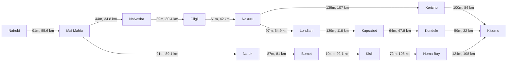
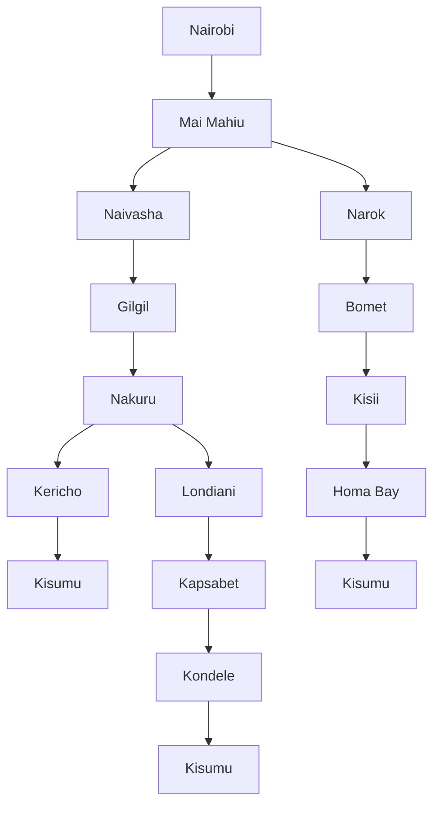
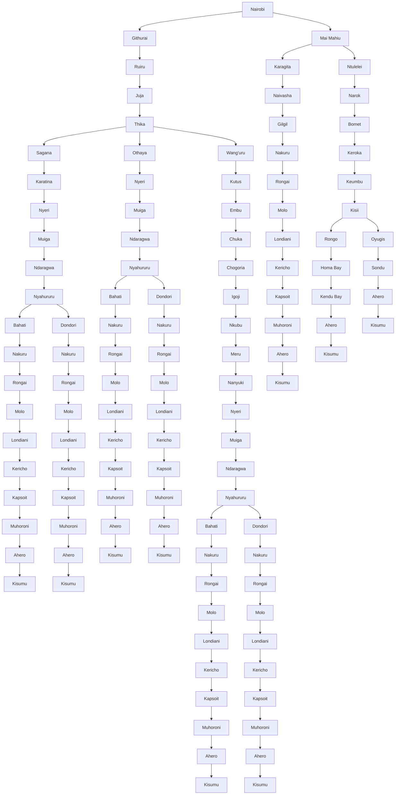

<hr>

# **Question 1**

### **PEAS Framework for self driving trailer**

* Performance Element - Distance Covered, Fuel Consumption, Time taken (Goal is to minimise them)
* Environment - The Kenyan Roads
* Actuators - Motors
* Sensors - Speedometer, Fuel Sensors

<hr>

# **Question 2**

**Directed Graph 1 - Compact**



**Directed Graph 2 - Stay on Trunk Roads**

```mermaid
graph LR
  Nairobi -->|26m, 16.3km| Githurai
  Githurai -->|17m, 9.6km| Ruiru
  Ruiru -->|14m, 9.1km| Juja
  Juja -->|20m, 13.3km| Thika
  Thika -->|114m, 86.8km| Othaya
  Thika -->|66m, 63.9km| Sagana
  Thika -->|70m, 63.1km| Wang_uru["Wang'uru"]
  Sagana -->|25m, 25.8km| Karatina
  Karatina -->|30m, 24.7km| Nyeri
  Othaya -->|23m, 16.9km| Nyeri
  Wang_uru["Wang'uru"] -->|70m, 63.1km| Kutus
  Kutus -->|32m, 19.3km| Embu
  Embu -->|59m, 43.8km| Chuka
  Chuka -->|23m, 15.8km| Chogoria
  Chogoria -->|16m, 10.3km| Igoji
  Igoji -->|24m, 16.7km| Nkubu
  Nkubu -->|31m, 16.6km| Meru
  Meru -->|81m, 76.2km| Nanyuki
  Nyeri -->|29m, 20.8km| Muiga
  Muiga -->|56m, 59.2km| Ndaragwa
  Nanyuki -->|70m, 61.0km| Nyeri
  Ndaragwa -->|30m, 26.2km| Nyahururu
  Nyahururu -->|46m, 42.3km| Bahati
  Bahati -->|39m, 21.0km| Nakuru
  Nyahururu -->|45m, 36.0km| Dondori
  Dondori -->|60m, 42.8km| Nakuru
  Nairobi -->|85m, 53.8km| MaiMahiu["Mai Mahiu"]
  MaiMahiu["Mai Mahiu"] -->|43m, 31.1km| Karagita
  MaiMahiu["Mai Mahiu"] -->|55m, 60.3km| Ntulelei
  Karagita -->|15m, 7.2km| Naivasha
  Naivasha -->|39m, 30.4km| Gilgil
  Gilgil -->|61m, 42.0km| Nakuru
  Ntulelei -->|30m, 28.8km| Narok
  Narok -->|82m, 81.0km| Bomet
  Bomet -->|65m, 56.9km| Keroka
  Keroka -->|20m, 14.3km| Keumbu
  Keumbu -->|18m, 12.2km| Kisii
  Kisii -->|36m, 26.0km| Rongo
  Rongo -->|38m, 31.0km| HomaBay["Homa Bay"]
  HomaBay["Homa Bay"] -->|33m, 31.2km| KenduBay["Kendu Bay"]
  KenduBay["Kendu Bay"] -->|53m, 53.3km| Ahero
  Kisii -->|38m, 25.3km| Oyugis
  Oyugis -->|40m, 38.0km| Sondu
  Sondu -->|18m, 29.5km| Ahero
  Ahero -->|32m, 23.5km| Kisumu
  Muhoroni -->|51m, 37.7km| Ahero
  Kapsoit -->|42m, 28.6km| Muhoroni
  Kericho -->|16m, 11.3km| Kapsoit
  Londiani -->|52m, 49.0km| Kericho
  Molo -->|31m, 22.1km| Londiani
  Rongai -->|73m, 46.7km| Molo
  Nakuru -->|58m, 33.2km| Rongai
```



**Search Tree 1 - Compact**



**Search Tree 2 - Stay on Trunk Roads**


<hr>

# Question 3:

### **Optimal Cost to get to Kisumu**

* Used the feature specified in the link to generate the distances between towns.
* All major towns along trunk roads were considered to be part of the graph
* Created a python file that traversed all the towns that were created and assigned weights using dijkstra's algorithm
* Code to do the same is written below.

```Python
import pprint
import heapq

class directed_graph:
    def __init__(self,directed=True):
        self.directed=directed
        self.adjacent = {}

    def add_vertex(self,vertex):
        if vertex not in self.adjacent.keys():
            self.adjacent[vertex] = []

    def add_edge(self,v1,v2,time,distance,directed=True):
        self.add_vertex(v1)
        self.add_vertex(v2)

        self.adjacent[v1].append((v2,time,distance))

        if not directed:
            self.adjacent[v2].append((v1,time,distance))

    def full_dict(self):
        pprint.pprint(self.adjacent)

    # Creates the entire graph
    def build(self):
        self.add_edge("Nairobi","Githurai","26m","16.3km")
        self.add_edge("Githurai","Ruiru","17m","9.6km")
        self.add_edge("Ruiru", "Juja", "14m", "9.1km")
        self.add_edge("Juja", "Thika", "20m", "13.3km")
        self.add_edge("Thika", "Othaya", "114m", "86.8km")
        self.add_edge("Thika", "Sagana", "66m", "63.9km")
        self.add_edge("Thika", "Wang'uru", "70m", "63.1km")
        self.add_edge("Sagana", "Karatina", "25m", "25.8km")
        self.add_edge("Karatina", "Nyeri", "30m", "24.7km")
        self.add_edge("Othaya", "Nyeri", "23m", "16.9km")
        self.add_edge("Wang'uru", "Kutus", "70m", "63.1km")
        self.add_edge("Kutus", "Embu", "32m", "19.3km")
        self.add_edge("Embu", "Chuka", "59m", "43.8km")
        self.add_edge("Chuka", "Chogoria", "23m", "15.8km")
        self.add_edge("Chogoria", "Igoji", "16m", "10.3km")
        self.add_edge("Igoji", "Nkubu", "24m", "16.7km")
        self.add_edge("Nkubu", "Meru", "31m", "16.6km")
        self.add_edge("Meru", "Nanyuki", "81m", "76.2km")
        self.add_edge("Nyeri", "Muiga", "29m", "20.8km")
        self.add_edge("Muiga", "Ndaragwa", "56m", "59.2km")
        self.add_edge("Nanyuki", "Nyeri", "70m", "61.0km")
        self.add_edge("Ndaragwa", "Nyahururu", "30m", "26.2km")
        self.add_edge("Nyahururu", "Bahati", "46m", "42.3km")
        self.add_edge("Bahati", "Nakuru", "39m", "21.0km")
        self.add_edge("Nyahururu", "Dondori", "45m", "36.0km")
        self.add_edge("Dondori", "Nakuru", "60m", "42.8km")
        self.add_edge("Nairobi", "Mai Mahiu", "85m", "53.8km")
        self.add_edge("Mai Mahiu", "Karagita", "43m", "31.1km")
        self.add_edge("Mai Mahiu", "Ntulelei", "55m", "60.3km")
        self.add_edge("Karagita", "Naivasha", "15m", "7.2km")
        self.add_edge("Naivasha", "Gilgil", "39m", "30.4km")
        self.add_edge("Gilgil", "Nakuru", "61m", "42.0km")
        self.add_edge("Ntulelei", "Narok", "30m", "28.8km")
        self.add_edge("Narok", "Bomet", "82m", "81.0km")
        self.add_edge("Bomet", "Keroka", "65m", "56.9km")
        self.add_edge("Keroka", "Keumbu", "20m", "14.3km")
        self.add_edge("Keumbu", "Kisii", "18m", "12.2km")
        self.add_edge("Kisii", "Rongo", "36m", "26.0km")
        self.add_edge("Rongo", "Homa Bay", "38m", "31.0km")
        self.add_edge("Homa Bay", "Kendu Bay", "33m", "31.2km")
        self.add_edge("Kendu Bay", "Ahero", "53m", "53.3km")
        self.add_edge("Kisii", "Oyugis", "38m", "25.3km")
        self.add_edge("Oyugis", "Sondu", "40m", "38.0km")
        self.add_edge("Sondu", "Ahero", "18m", "29.5km")
        self.add_edge("Ahero", "Kisumu", "32m", "23.5km")
        self.add_edge("Muhoroni", "Ahero", "51m", "37.7km")
        self.add_edge("Kapsoit", "Muhoroni", "42m", "28.6km")
        self.add_edge("Kericho", "Kapsoit", "16m", "11.3km")
        self.add_edge("Londiani", "Kericho", "52m", "49.0km")
        self.add_edge("Molo", "Londiani", "31m", "22.1km")
        self.add_edge("Rongai", "Molo", "73m", "46.7km")
        self.add_edge("Nakuru", "Rongai", "58m", "33.2km")

    def simple_build(self):
        self.add_edge("Nairobi", "Mai Mahiu", "91m", "55.6 km")
        self.add_edge("Mai Mahiu", "Naivasha", "44m", "34.8 km")
        self.add_edge("Mai Mahiu", "Narok", "91m", "89.1 km")
        self.add_edge("Naivasha", "Gilgil", "39m", "30.4 km")
        self.add_edge("Gilgil", "Nakuru", "61m", "42 km")
        self.add_edge("Nakuru", "Kericho", "139m", "107 km")
        self.add_edge("Nakuru", "Londiani", "97m", "64.9 km")
        self.add_edge("Kericho", "Kisumu", "100m", "84 km")
        self.add_edge("Londiani", "Kapsabet", "139m", "116 km")
        self.add_edge("Kapsabet", "Kondele", "64m", "47.8 km")
        self.add_edge("Kondele", "Kisumu", "59m", "32 km")
        self.add_edge("Narok", "Bomet", "87m", "81 km")
        self.add_edge("Bomet", "Kisii", "104m", "92.1 km")
        self.add_edge("Kisii", "Homa Bay", "72m", "108 km")
        self.add_edge("Homa Bay", "Kisumu", "124m", "108 km")

    def dijkstras(self,start_node):
        distances = {towns:float('inf') for towns in self.adjacent}
        distances[start_node] = 0
        previous_nodes = {towns:None for towns in self.adjacent}
        pq=[(0,start_node)]

        while pq:
            current_distance,current_town = heapq.heappop(pq)
            if current_distance > distances[current_town]:
                continue

            for neighbor,time,distance_between in self.adjacent[current_town]:
                # distance = current_distance + float(time[:-1])
                distance = current_distance + float(distance_between[:-2])

                if distance < distances[neighbor]:
                    distances[neighbor] = distance
                    previous_nodes[neighbor] = current_town
                    heapq.heappush(pq,(distance,neighbor))

        return distances,previous_nodes

    def get_shortest_path(self,start_node,end_node):
        distances,previous_nodes = self.dijkstras(start_node)

        path = []
        current = end_node
        while current is not None:
               path.insert(0,current)
               current = previous_nodes[current]

        return distances[end_node],path

NaiToKis = directed_graph()
NaiToKis.simple_build()
shortest_path,path = NaiToKis.get_shortest_path('Nairobi','Kisumu')
# print("Shortest path time is "+str(shortest_path/60)+" hours.")
print("Shortest path distance is "+str(shortest_path)+" km.")
print("Path followed is:")
print(path)

NaiToKis.adjacent={}
NaiToKis.build()
shortest_path,path = NaiToKis.get_shortest_path('Nairobi','Kisumu')
# print("Shortest path time is "+str(shortest_path/60)+" hours.")
print("Shortest path distance is "+str(shortest_path)+" km.")
print("Path followed is:")
print(path)
```

* None of the code is copied directed from an AI and can be explained upon request.
* The final output of the program is:

```bash
Shortest path distance is 416.6 km.

Path followed is:
['Nairobi', 'Mai Mahiu', 'Karagita', 'Naivasha', 'Gilgil', 'Nakuru', 'Rongai', 'Molo', 'Londiani', 'Kericho', 'Kapsoit', 'Muhoroni', 'Ahero', 'Kisumu']
```

* If edited to prioritise time:

```bash
Shortest path distance is 8.05 hours.

Path followed is:
['Nairobi', 'Mai Mahiu', 'Ntulelei', 'Narok', 'Bomet', 'Keroka', 'Keumbu', 'Kisii', 'Oyugis', 'Sondu', 'Ahero', 'Kisumu']
```

* The path's followed remains the same either way

* If using the direct towns to towns measure

```bash
Shortest path distance is 353.8 km.

Path followed is:
['Nairobi', 'Mai Mahiu', 'Naivasha', 'Gilgil', 'Nakuru', 'Kericho', 'Kisumu']
```

* If using time to measure

```bash
Shortest path time is 7.9 hours.

Path followed is:
['Nairobi', 'Mai Mahiu', 'Naivasha', 'Gilgil', 'Nakuru', 'Kericho', 'Kisumu']
```

<hr>

# TeamWork Proof

* Image taken
[!](https://www.google.com/)